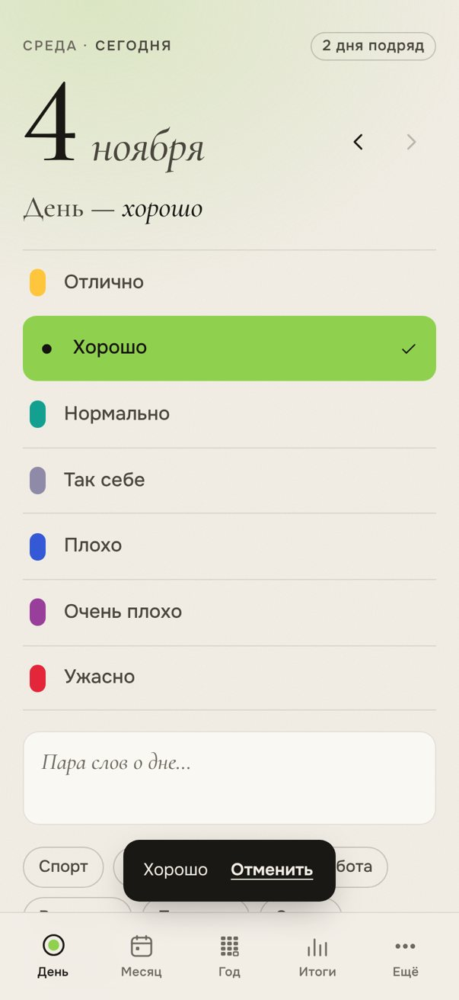
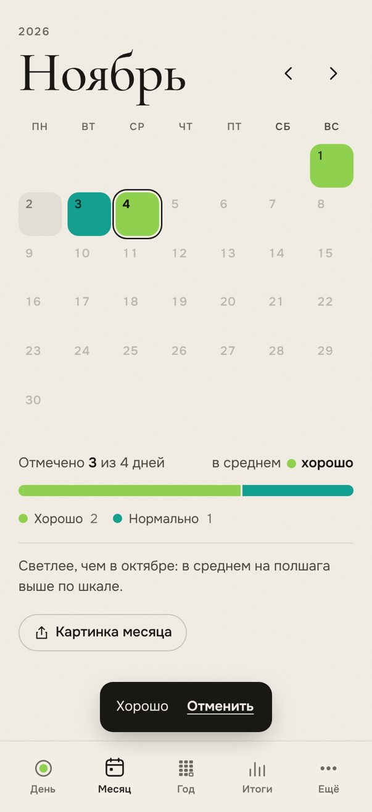
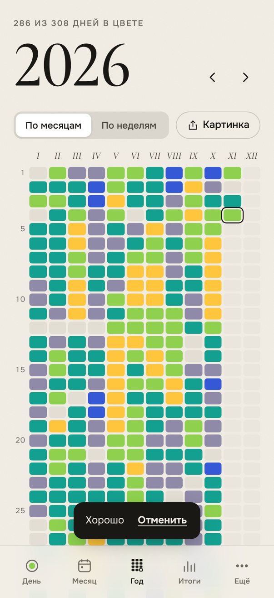
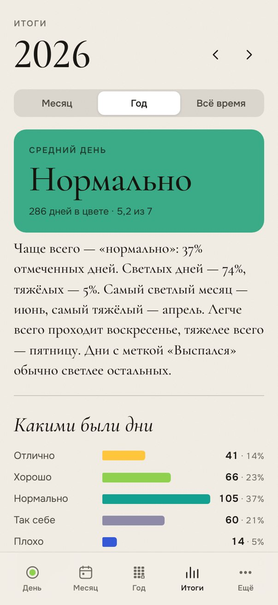
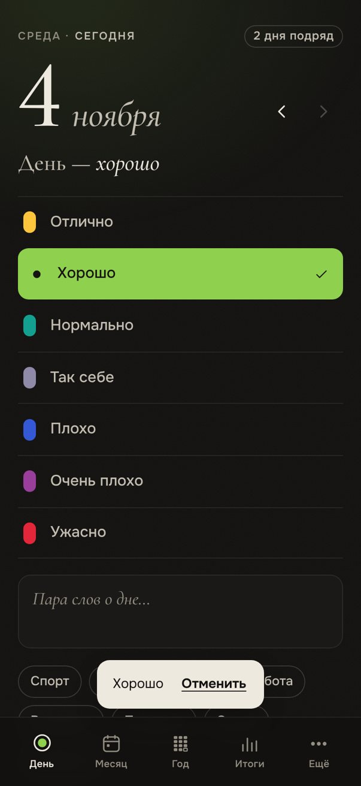
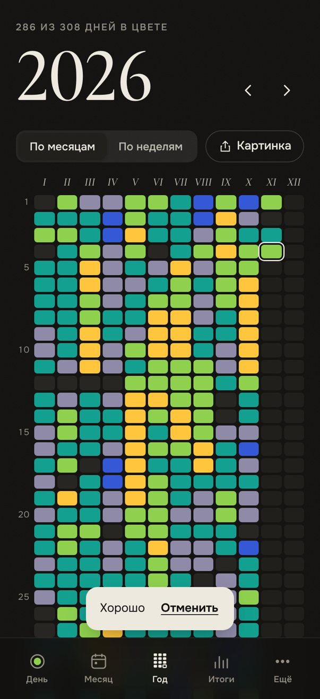

# Оттенки

Календарь настроения: каждый день — один цвет. Через месяц получается узор, через год — картина.

**Открыть:** https://mihailmoskalenko08-eng.github.io/mood-calendar/

<p>
  
  
  
  
</p>
<p>
  
  
</p>

## Как поставить на iPhone

1. Откройте ссылку в **Safari**.
2. Нажмите «Поделиться» → **«На экран „Домой“»**.
3. Запускайте с иконки: на весь экран, работает без интернета.

> Safari и приложение с иконки хранят данные **отдельно**. Отмечайте дни в приложении с иконки.
> Если что-то уже отметили в Safari — «Ещё → Данные → Сохранить копию», затем «Загрузить копию» в приложении
> (или прямо на первом экране: «Уже вели „Оттенки“? Загрузить копию»).

## Что умеет

**День**
- Отметка в одно касание по своей шкале от 2 до 10 цветов; цвет мягко заливает строку, фон окрашивается в тон дня.
- Заметка и метки («спорт», «друзья», «выспался»…). Всё сохраняется само.
- «Отменить» после каждой отметки, «Убрать отметку».
- Листание дней свайпом или стрелками, нажатие на дату — выбор любого дня в календаре.
- Подсказка, если вчерашний день остался без цвета; «В этот день» — тот же день год назад и раньше.
- Полоса недели, серия дней подряд, праздник на 7, 30, 100, 365 дней.

**Месяц** — сетка дней в цвете, сколько отмечено, средний день, распределение, сравнение с прошлым месяцем,
картинка месяца для сторис. Нажатие на день открывает нижнюю панель с той же шкалой, заметкой и метками.

**Год** — каждый день пикселем, по месяцам (I–XII) или по неделям. Зажмите палец на сетке и ведите — над пальцем
видно дату, настроение и начало заметки. Нажатие на месяц открывает его. Картинка года 1080×1920.

**Итоги** за месяц, год или всё время: средний день, рассказ о периоде простыми словами, распределение,
средние по месяцам и дням недели, серии, какие метки связаны со светлыми и тяжёлыми днями, поиск по записям.

**Ещё**
- Шкала: 7 палитр, свои названия и цвета, порядок, добавление и удаление уровней (отметки переезжают на соседний).
- Метки, тема (авто, светлая, тёмная), начало недели.
- Код-пароль: экран с цифрами при запуске и после 30 секунд вне приложения; пока приложение свёрнуто,
  дневник закрыт шторкой.
- Напоминание через «Команды» (пошаговая инструкция).
- Копия в JSON (в «Файлы» через «Поделиться»), таблица CSV, загрузка копии — объединить или заменить.
  Если копии не было месяц, на главном экране появится напоминание.

Стандартная шкала: алый — ужасно, сливовый — очень плохо, синий — плохо, сизый — так себе,
бирюзовый — нормально, салатовый — хорошо, солнечный — отлично.

## Данные

Всё хранится только на устройстве (localStorage) — без серверов, регистрации и аналитики.
- При каждой записи предыдущая версия остаётся запасной; если основная повредится, данные поднимутся из запасной.
- Если прочитать не удаётся ни одну, данные не затираются: они откладываются, а приложение предлагает их скачать.
- Слияние копий не теряет заметки и метки ни с одной стороны.
- Код-пароль хранится отдельно (PBKDF2-хеш) и в копии не попадает. Он закрывает экран от случайного взгляда,
  но не шифрует сами отметки.

Раз в месяц стоит сохранять копию в «Файлы» — на случай смены телефона.

## Разработка

```bash
npm install
npm run dev          # локальный сервер
npm test             # модульные тесты (vitest)
npx tsc --noEmit     # проверка типов
npm run build        # сборка в dist/
npx vite preview --port 4173 &   # затем:
npm run e2e          # сквозные проверки в Chromium на экране iPhone 17
npm run shots        # скриншоты в shots/ (npm run shots -- dark — тёмная тема)
npm run icons        # иконки и заставки запуска из SVG
```

Vite + Preact + @preact/signals + TypeScript, без UI-библиотек. Шрифты Cormorant Garamond и Onest лежат
локально (Fontsource). Сервис-воркер — vite-plugin-pwa: новая версия ставится, когда приложение свёрнуто,
или по кнопке «Обновить». Каждый push в `main` проверяется (типы, тесты), собирается и выкладывается
на GitHub Pages (`.github/workflows/pages.yml`). Lighthouse: доступность 100, скорость 96–98.

```
src/
  lib/        даты, цвет (OKLab), модель, хранение и копии, статистика, картинки, код-пароль, отклик, конфетти
  components/ экраны Today, Month, Year, Stats, Settings, Onboarding, Lock; DayEditor, ui, icons
  state.ts    состояние и все изменения данных
  backup.ts   сохранение и чтение копий
  styles.css  оформление: токены светлой и тёмной темы, без фреймворков
scripts/      сквозные проверки, скриншоты, иконки и заставки
tests/        модульные тесты
```
